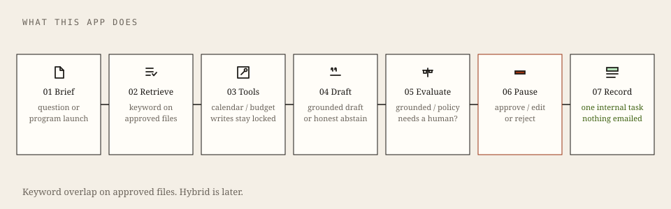
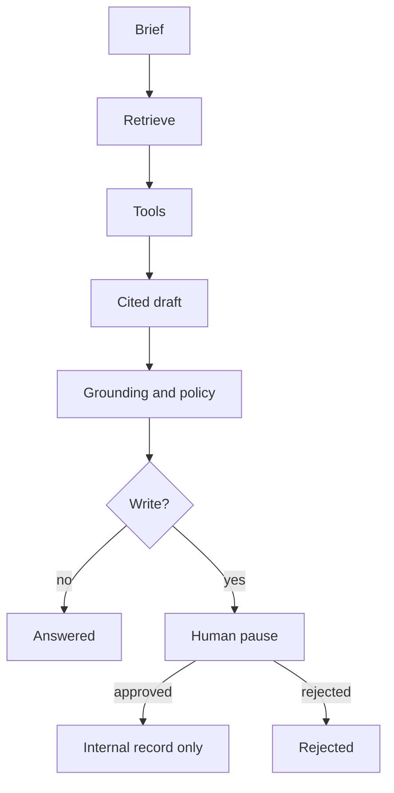
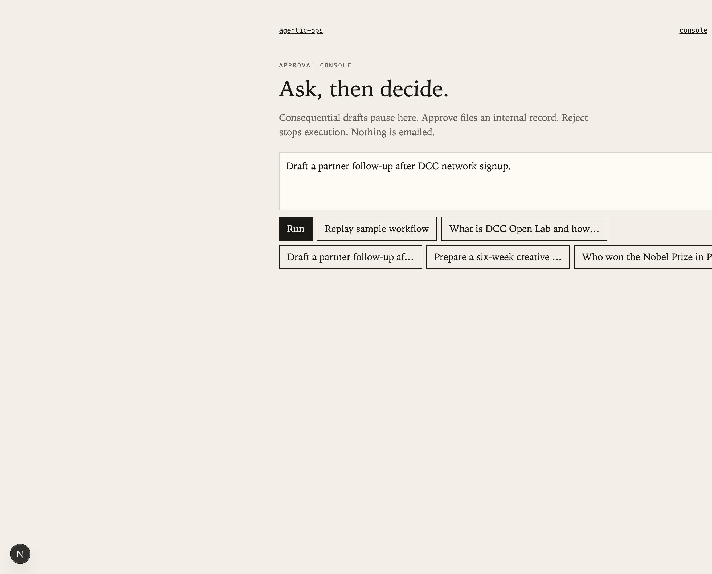
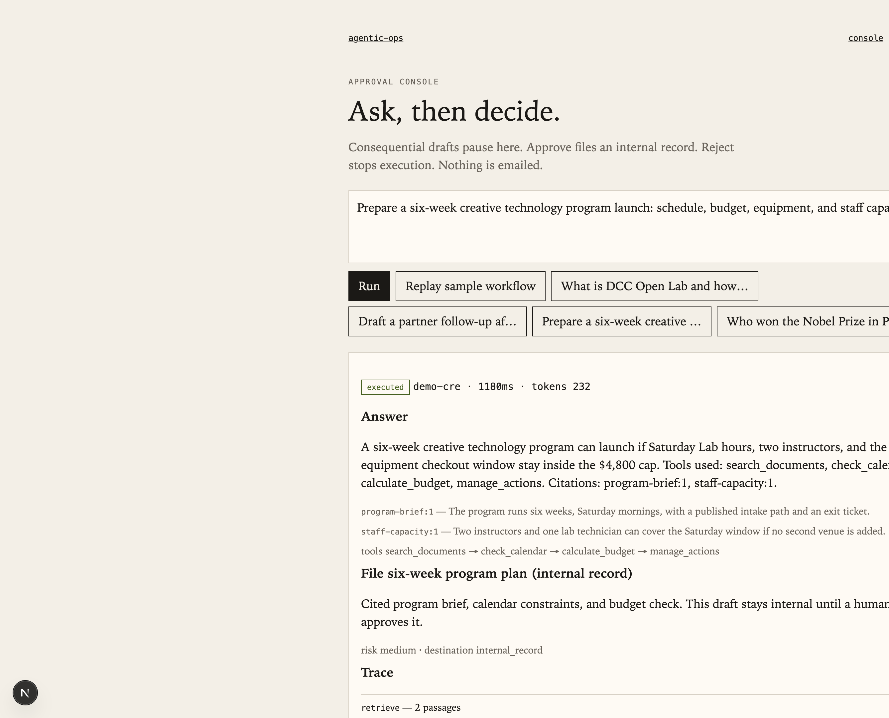
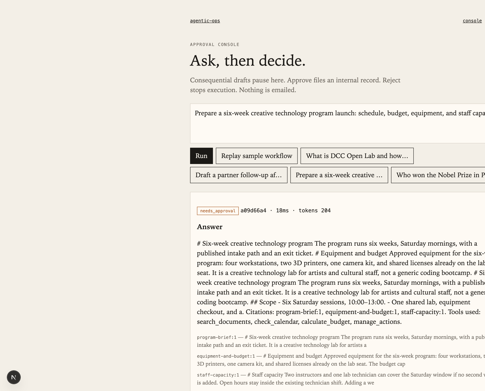

<p align="center">
  
</p>

# Agentic Ops

### Retrieve. Cite. Pause. Record.

A governed agent for organizational work. Someone asks a handbook question or a program-launch brief. The runtime retrieves approved files, calls permissioned tools, cites its sources, and **stops before any write**. A person approves or rejects. The audit trail stays.

Not a chatbot. Nothing is emailed. Public/synthetic corpus only. Fake provider is the CI default — recruiters need no API key.

[What it does](#what-this-app-does) ·
[Try it](#try-it-no-keys) ·
[Console](#approval-console) ·
[Roadmap](#roadmap) ·
[FDE map](#what-this-proves-for-fde-hiring) ·
[Run locally](#run-it-locally)


<p align="center">
  
</p>

## What this app does

| You give it | It does | It will not |
| --- | --- | --- |
| A handbook question | Cited answer, or “I do not have approved records” | Invent a Nobel prize, a grant, or a KPI |
| A six-week program launch | Retrieve brief + calendar + budget, then pause | Send calendar invites or buy equipment |
| An intake / write ticket | Cite policy and wait for a reviewer | Close the ticket or write a directory |

Four tools, one permission model:

| Tool | Permission | Role |
| --- | --- | --- |
| `search_documents` | READ | RAG over the org corpus |
| `check_calendar` | READ | Staff capacity / windows |
| `calculate_budget` | READ | Line items vs cap |
| `manage_actions` | WRITE | Tasks stay `pending_approval` until a human decides |



## Try it (no keys)

```bash
python3 -m venv .venv && source .venv/bin/activate
make install && make verify && make agent-dev
# other terminal:
cd apps/web && npm install && npm run dev
```

Open [http://localhost:3000/console](http://localhost:3000/console) and click **Replay sample workflow**.

Or: `curl -s -X POST http://localhost:8080/v1/demo/replay`

## Approval console

Three real paths. Same screen.

| | |
| --- | --- |
| **Ask** | Handbook, program launch, intake, or the Nobel trap |
| **Replay** | Stored six-week launch — retrieve → tools → cite → approved execute |
| **Pause** | Live run waits on **Approve draft** / **Reject** |

<p align="center">
  
</p>

<p align="center">
  
</p>

<p align="center">
  
</p>

## Three briefs

1. **Handbook** — “What is DCC Open Lab and how does it differ from workshops?” → cited answer.
2. **Launch** — “Prepare a six-week creative technology program…” → calendar + budget + pending WRITE.
3. **Refusal** — “Who won the Nobel Prize at DCC last Tuesday?” → fail closed, no fabrication.

Engagement writeups (discovery through handover): [`docs/engagement/`](docs/engagement/). Interview cases: [`docs/cases/`](docs/cases/).

## Roadmap

<p align="center">
  
</p>

<p align="center">
  
</p>

| Now | Next (this repo) | Later / skip |
| --- | --- | --- |
| Tools, cited RAG, MCP-shaped catalog, HITL, offline evals, FDE docs | **OPS-05** hybrid retrieval, **OPS-08** cost CI, **OPS-07** streaming timeline | Live providers, hosted demo, `v0.1.0` |
| | | **Skip:** fine-tune, voice clones, travel planner, triple-cloud capstone |

Daily board: [`docs/DAILY.md`](docs/DAILY.md) · skill map: [`docs/FDE-ROADMAP.md`](docs/FDE-ROADMAP.md)

## What this proves for FDE hiring

One customer-shaped system instead of eight course toys. The FDE lifecycle (discover → scope → wire tools → eval → handover) is in this repo; live DCC delivery stays in Infra24.

| FDE skill | In this repo | Honest gap |
| --- | --- | --- |
| When to use an agent | [`docs/cases/01-should-this-be-an-agent.md`](docs/cases/01-should-this-be-an-agent.md) | — |
| Grounded RAG | Citation allowlist + golden set | Dense/hybrid is OPS-05 |
| MCP / tool RBAC | Four tools, WRITE pending | No Entra / multi-tenant OAuth |
| HITL | LangGraph `interrupt` + console | Streaming UX is OPS-07 |
| Evals as a gate | `make eval-offline` | Not yet a cost/deploy CI fail (OPS-08) |
| Discovery / handover | [`docs/engagement/`](docs/engagement/) | No priced SoW |
| Decomposition cases | [`docs/cases/`](docs/cases/) | Three cases, not a 10-scenario library |
| Multi-agent planner/critic | Not split yet | Optional, same graph only |
| Fine-tuning | Out of scope | Keep skipped |

Sister overlays (do not duplicate): [evidence pipeline](https://github.com/moisestech/agentic-evidence-pipeline) · [flora-field-kit](https://github.com/moisestech/flora-field-kit) · [comfyui-output-provenance](https://github.com/moisestech/comfyui-output-provenance)

## What works today

| Area | Status | Proof |
| --- | --- | --- |
| FastAPI + OpenAPI + health | **done** | `/health`, `/docs` |
| Keyword retrieval + citations | **done** | Nobel trap + golden set |
| Tools + MCP-shaped server | **done** | `GET /v1/tools`, `make mcp` |
| HITL interrupt | **done** | `POST /v1/runs/{id}/decision` |
| Demo replay (no keys) | **done** | `POST /v1/demo/replay` |
| Offline eval | **done** | `make eval-offline` |
| Approval console | **done** | `apps/web` |
| pgvector hybrid | pending | OPS-05 — Compose image is present |
| Cost CI budget gate | pending | OPS-08 |
| Streaming tool-state | pending | OPS-07 |
| Live OpenAI / Claude / Bedrock | pending | Fake stays default |

## Run it locally

Python 3.11+, Node 20+, Docker optional.

```bash
make verify          # ruff + pytest
make eval-offline    # golden-set report
make demo            # print stored recruiter run
make mcp             # stdio tool server
docker compose up --build
```

No provider credential is required. `AGENT_PROVIDER=fake` is the supported path.

## Repository shape

```text
apps/web/               Approval console
services/agent/         FastAPI + LangGraph + tools + MCP
packages/evals/         Golden set + dated reports
data/                   dcc-public, creative-program, enterprise-intake
scenarios/              Calendar / budget fixtures
fixtures/demo-run.json  Recruiter replay
docs/engagement/        Discovery → handover
docs/cases/             Interview writeups
docs/assets/            Marks, diagrams, console screenshots
```

## Status and limitations

**Status:** scaffold toward `v0.1.0`. OPS-01–04, 11–12 are done. Hybrid retrieval, cost CI, and a hosted demo are not.

This is a public reference — not customer production, not a live Infra24 deploy, not AWS AgentCore, not ServiceNow ownership.

[Moises Sanabria](https://moises.tech) — artist and full-stack AI systems builder in Miami.

## License

[MIT](LICENSE)
