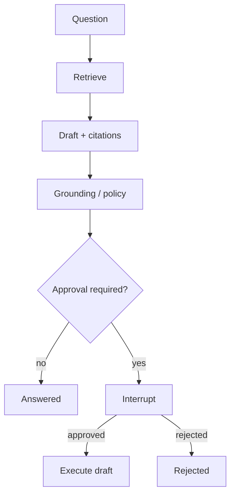

<p align="center">
  
</p>

# Agentic Ops

### Retrieve. Cite. Pause. Record.

<p align="center">
  
</p>

A governed agent system that answers from approved institutional records, proposes operational actions, waits for a person, and writes an auditable execution record.

[Status](#what-works-today) ·
[Companion boundary](#companion-boundary) ·
[FDE roadmap](docs/FDE-ROADMAP.md) ·
[Workflow](#product-workflow) ·
[Run locally](#run-it-locally) ·
[Hiring map](#what-this-repository-proves)


## The 30-second version

| | |
| --- | --- |
| **Input** | An institutional question or operational brief |
| **Work** | Hybrid retrieval + LangGraph draft + grounding/policy evaluators |
| **Guarantee** | Unsupported citations fail closed; consequential actions pause |
| **Output** | Cited answer, optional approved draft, append-only run record |
| **Inspectability** | Passages, citations, interrupts, latency, tokens, outcome |

Not a chatbot. No autonomous email. Public/synthetic corpus only.

## Companion boundary

Infra24 is the live customer-delivery case (DCC Memory Agent, Network Readiness). This repository is the recruiter-readable reference — Python, LangGraph, Vercel AI SDK, evals — without burying those skills inside a 2,300-file platform.

| Repo | Role |
| --- | --- |
| [`moisestech/infra24`](https://github.com/moisestech/infra24) | Production DCC platform. Compare against `/o/dcc/memory-agent`. |
| [`moisestech/agentic-evidence-pipeline`](https://github.com/moisestech/agentic-evidence-pipeline) | TypeScript governance overlay. |
| [`moisestech/flora-field-kit`](https://github.com/moisestech/flora-field-kit) | Creative FDE overlay. |
| [`moisestech/comfyui-output-provenance`](https://github.com/moisestech/comfyui-output-provenance) | Production OSS overlay. |
| **`moisestech/agentic-ops`** | This repo. Portable teaching set + governed agent service. |

FDE skill map and remaining work: [`docs/FDE-ROADMAP.md`](docs/FDE-ROADMAP.md).

P1 Infra24 work (credential rotation, pgvector migration, embedding sync, lockfile repair) stays in Infra24. Do not treat this scaffold as a substitute for those live checks.

## What works today

| Area | Status | Proof |
| --- | --- | --- |
| FastAPI service, OpenAPI, health/ready | **done** | `/health`, `/docs` |
| LangChain chunking + keyword retrieval | **done** | `tests/test_retrieval.py` |
| LangGraph retrieve → draft → evaluate → interrupt | **done** | `tests/test_graph_interrupt.py` |
| Citation / policy gate | **done** | fail-closed Nobel trap + allowlist |
| Human approval before execute | **done** | `POST /v1/runs/{id}/decision` |
| Offline golden eval | **done** | `make eval-offline` |
| Next.js approval console | **done** | `apps/web` |
| pgvector hybrid retrieval | pending | Compose image is present |
| OpenAI / Claude parity tests | pending | adapters reserved |
| Vercel AI SDK streaming | pending | `ai` dependency reserved for OPS-07 |
| Bedrock / SageMaker eval | pending | `infra/aws` |

## Product workflow

1. Receive an institutional question or operational brief.
2. Retrieve approved records and source passages.
3. Produce a cited answer and proposed action plan.
4. Select tools through a LangGraph workflow.
5. Run grounding and policy evaluators.
6. Pause for human approval.
7. Execute only the approved draft action (internal record in v0).
8. Store citations, decisions, latency, tokens, cost, and outcome.



## What this repository proves

| Hiring gap | Where to look |
| --- | --- |
| Python | `services/agent` FastAPI + typed Pydantic models + pytest |
| RAG | Keyword retrieval with citations; vector path planned on pgvector |
| Vector database | Compose `pgvector/pgvector:pg16`; hybrid retrieval is OPS-05 |
| LangChain | `langchain-text-splitters` chunking of `data/dcc-public` |
| LangGraph | Explicit graph, MemorySaver, `interrupt()` / `Command(resume=…)` |
| AI agents | Multi-step retrieve/draft/evaluate/execute |
| Human-in-the-loop | Approval interrupt before consequential actions |
| MCP / tools | Four permissioned tools; `GET /v1/tools`; `python -m agentic_ops.mcp` |
| FDE delivery | `docs/engagement/` discovery through handover; `docs/cases/` interview writeups |
| Vercel AI SDK | Next.js console; streaming tool-state is OPS-07 |
| OpenAI / Claude | Provider adapters reserved; fake provider is CI-default |
| AWS AI / SageMaker | `infra/aws` — not claimed until a dated report exists |
| Production engineering | Docker, CI, OpenAPI, health checks |
| Observability | Latency, tokens, cost fields on every run |
| Evaluation | `packages/evals/golden-set.json` + dated reports |
| Instructional design | `docs/course-lab` |

## Run it locally

Python 3.11+, Node 20+, Docker optional.

```bash
python3 -m venv .venv
source .venv/bin/activate
make install
cp .env.example .env
make verify
make agent-dev
```

In another terminal:

```bash
cd apps/web && npm install && npm run dev
```

Open `http://localhost:3000/console`. Click **Replay sample workflow** — no API keys.

Or inspect the stored run:

```bash
make demo
curl -s -X POST http://localhost:8080/v1/demo/replay
```

| Command | Meaning |
| --- | --- |
| `make verify` | Ruff + pytest (CI gate) |
| `make eval-offline` | Golden-set report under `packages/evals/reports/` |
| `make demo` | Print the deterministic recruiter replay |
| `make mcp` | Stdio MCP-shaped tool server |
| `make openapi` | Export FastAPI schema to `packages/contracts/` |
| `docker compose up --build` | Postgres + agent + web |

No provider credential is required. `AGENT_PROVIDER=fake` is the supported path.

## Repository shape

```text
agentic-ops/
├── apps/web/               Next.js approval console
├── services/agent/         Python + FastAPI + LangGraph + tools + MCP
├── packages/contracts/     OpenAPI
├── packages/evals/         Golden fixtures and dated reports
├── packages/mcp/           Tool-server notes
├── data/dcc-public/        DCC public sample corpus
├── data/creative-program/  Institution-launch corpus
├── data/enterprise-intake/ ITSM-shaped policy corpus
├── scenarios/              Calendar / budget fixtures per org
├── fixtures/demo-run.json  Recruiter replay (no keys)
├── docs/engagement/        Discovery → handover
├── docs/cases/             FDE interview writeups
├── docs/architecture/
├── docs/decisions/
├── docs/course-lab/
└── docs/threat-model.md
```

## Status and limitations

**Status:** scaffold toward `v0.1.0` (OPS-01–OPS-04).

This is a public reference implementation — not customer production, not a live Infra24 deploy, and not an AWS production claim. Hurix page and GitHub profile updates wait on verified results.

## Origin

Built as the companion to DCC / Infra24 applied-AI work: Memory Agent retrieval as the production comparison, Network Readiness as the real approval scenario, same golden questions across stacks.

[Moises Sanabria](https://moises.tech) — full-stack AI systems builder and artist in Miami.

## License

[MIT](LICENSE)
