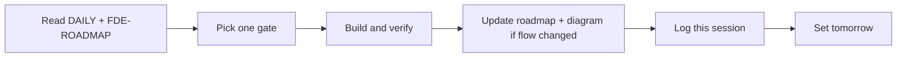

# Daily FDE session

Use this file at the start and end of every working day. One gate per session. Update the status tables in [`FDE-ROADMAP.md`](FDE-ROADMAP.md) when a gate actually changes.

## How a session works

1. Read **Today** below and the matching repo roadmap.
2. Implement only that gate. Do not open a fifth product repo.
3. Verify with the command named on the gate.
4. If the runtime flow changed, update the mermaid in `FDE-ROADMAP.md` and the console/README screenshot note.
5. Prepend a log entry. Move today’s gate to done or leave it if blocked.
6. Write **Tomorrow** as one line.

## Today — 2026-08-31

- [x] Recruiter README: what the app does, console screenshots, readable roadmap diagrams
- [x] Homepage as an architecture + FDE dossier (not a two-card stub)
- [x] **OPS-05A** durable runs / checkpoints / one internal task (`make verify-recruiter`)
- Next engineering gate: **OPS-05B** hybrid retrieval + RRF (keyword stays fallback)

## Tomorrow

**OPS-05B** hybrid retrieval. Do not start a search-demo repo. Streaming and cost CI stay later.

## Board

| Gate | Repo | Status |
| --- | --- | --- |
| OPS-05A durable state / task ledger | agentic-ops | done |
| OPS-05B pgvector hybrid | agentic-ops | queued |
| OPS-08 cost CI | agentic-ops | queued |
| OPS-07 stream tool-state | agentic-ops | queued |
| AEP-10 traces / cost | agentic-evidence-pipeline | queued |
| AEP-11 doctor / demo | agentic-evidence-pipeline | queued |
| Field Kit hero slugs + handover | flora-field-kit | queued |
| Provenance M1 fixtures | comfyui-output-provenance | queued |

## Log

### 2026-08-31

- OPS-05A: Postgres runs/decisions/internal_tasks/audit_events + LangGraph PostgresSaver. Approve or edit-and-approve files one task. Same decision retries 200; conflict 409.
- Operator console is seven stages. Program Launch leads. Walkthrough in `docs/WALKTHROUGH.md`.
- README leads with product behavior, three briefs, console screenshots, and done/next/later roadmap SVGs.
- Homepage redesigned: architecture steps, tool permissions, two-stack FDE fit, honest status.
- Workflow mermaid now includes the tools node.

### 2026-08-29

- Chose four existing repos; no IK clones.
- Shipped agentic-ops runtime extras (MCP-shaped tools, demo replay, two scenarios, engagement + interview docs).
- Added per-repo FDE roadmaps.
- Added spine SVG/PNG, ops mark, and this daily protocol.
- Published https://github.com/moisestech/agentic-ops and overlay `docs/fde-roadmap` branches.

## Visuals to keep current

| Asset | Update when |
| --- | --- |
| [`assets/fde-spine.svg`](assets/fde-spine.svg) | A repo is added or a lane changes |
| [`assets/fde-spine-hero.png`](assets/fde-spine-hero.png) | Same, after a real status change |
| [`assets/ops-mark.svg`](assets/ops-mark.svg) | Runtime metaphor changes |
| Console **Program Launch** player | Demo fixture or approval path changes |
| [`assets/what-the-app-does.svg`](assets/what-the-app-does.svg) | Runtime steps change |
| [`assets/chat-vs-loop.svg`](assets/chat-vs-loop.svg) | Chat-vs-agent thesis changes |
| [`assets/tool-fence.svg`](assets/tool-fence.svg) | Tool catalog or WRITE rule changes |
| [`assets/state-vs-retrieval.svg`](assets/state-vs-retrieval.svg) | Persistence or retrieval story changes |
| [`assets/duty-split.svg`](assets/duty-split.svg) | Code / model / human split changes |
| [`assets/ops-icons.svg`](assets/ops-icons.svg) | Stage marks change |
| [`assets/roadmap-bands.svg`](assets/roadmap-bands.svg) | Done / next / later changes |
| [`assets/screenshots/`](assets/screenshots/) | Console UX changes |
