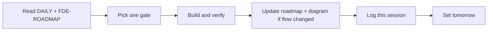

# Daily FDE session

Use this file at the start and end of every working day. One gate per session. Update the status tables in [`FDE-ROADMAP.md`](FDE-ROADMAP.md) when a gate actually changes.

## How a session works

1. Read **Today** below and the matching repo roadmap.
2. Implement only that gate. Do not open a fifth product repo.
3. Verify with the command named on the gate.
4. If the runtime flow changed, update the mermaid in `FDE-ROADMAP.md` and the console/README screenshot note.
5. Prepend a log entry. Move today’s gate to done or leave it if blocked.
6. Write **Tomorrow** as one line.

## Today — 2026-08-29

- [x] Scaffold four-repo FDE roadmaps
- [x] Add spine diagram, marks, and this daily file
- [ ] Push `agentic-ops` `main` (create GitHub repo if missing)
- [ ] Push overlay branches `docs/fde-roadmap`
- Next engineering gate after push: **OPS-05** hybrid retrieval

## Tomorrow

Push remotes if still local-only, then start OPS-05 in `agentic-ops`.

## Board

| Gate | Repo | Status |
| --- | --- | --- |
| OPS-05 pgvector hybrid | agentic-ops | next |
| OPS-08 cost CI | agentic-ops | queued |
| OPS-07 stream tool-state | agentic-ops | queued |
| AEP-10 traces / cost | agentic-evidence-pipeline | queued |
| AEP-11 doctor / demo | agentic-evidence-pipeline | queued |
| Field Kit hero slugs + handover | flora-field-kit | queued |
| Provenance M1 fixtures | comfyui-output-provenance | queued |

## Log

### 2026-08-29

- Chose four existing repos; no IK clones.
- Shipped agentic-ops runtime extras (MCP-shaped tools, demo replay, two scenarios, engagement + interview docs).
- Added per-repo FDE roadmaps.
- Added spine SVG/PNG, ops mark, and this daily protocol.
- GitHub push still pending approval in this environment.

## Visuals to keep current

| Asset | Update when |
| --- | --- |
| [`assets/fde-spine.svg`](assets/fde-spine.svg) | A repo is added or a lane changes |
| [`assets/fde-spine-hero.png`](assets/fde-spine-hero.png) | Same, after a real status change |
| [`assets/ops-mark.svg`](assets/ops-mark.svg) | Runtime metaphor changes |
| Console **Replay sample workflow** | Demo fixture or approval path changes |
