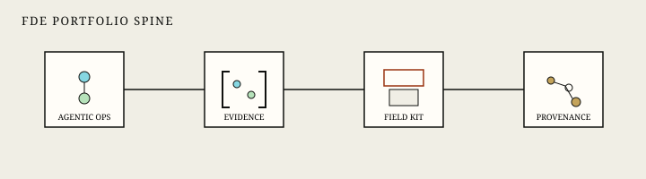
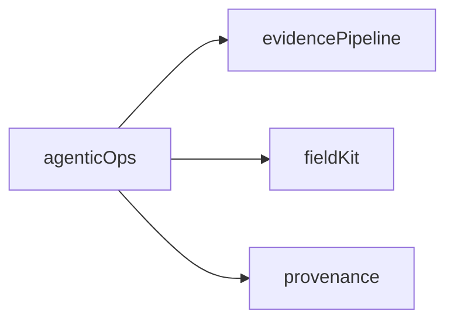

# FDE portfolio spine

  

  

This is the **AI-engineering + FDE-craft** repo. The other three existing repos cover governance, creative delivery, and production OSS. There is no fifth product repo and no Interview Kickstart project clones.

Daily protocol: [`DAILY.md`](DAILY.md).

| Repo | Lane | Open this for |
| --- | --- | --- |
| **[agentic-ops](https://github.com/moisestech/agentic-ops)** (this repo) | Agents, RAG, MCP, HITL, evals, engagement docs | Frontier / platform FDE |
| **[agentic-evidence-pipeline](https://github.com/moisestech/agentic-evidence-pipeline)** | Typed citations, fail-closed policy, durable jobs | Consulting / Deloitte inspect |
| **[flora-field-kit](https://github.com/moisestech/flora-field-kit)** | Brief → techniques → review → case study | Creative FDE |
| **[comfyui-output-provenance](https://github.com/moisestech/comfyui-output-provenance)** | CI, docs, tests, auditability | Engineering quality |

Skip everywhere: fine-tuning / LoRA, travel planners, voice ecommerce, triple-cloud capstones.

## Skill map (course weeks → this repo)

| Skill | Status | Where |
| --- | --- | --- |
| W1 ReAct / tools | **done** | LangGraph nodes + four-tool catalog |
| W2–3 RAG + groundedness | **done (keyword)** | `search_documents`, citation gate, golden set |
| W4 multi-agent | **not started** | Optional planner → executor → critic *inside this graph only* |
| W5 HITL UX | **partial** | Approval interrupt exists; streaming UI is OPS-07 |
| W6 MCP | **done (shaped)** | `python -m agentic_ops.mcp`, `GET /v1/tools` |
| W7 hybrid search | **pending** | OPS-05 pgvector + RRF; do not start a search-demo repo |
| W8 evals, safety, cost | **partial** | Offline harness green; cost CI budget is OPS-08 |
| W9 fine-tune | **out of scope** | Honest gap |
| W10–11 capstone | **this repo** | Institution-launch + enterprise-intake scenarios |
| FDE craft | **done (docs)** | [`docs/engagement/`](engagement/) |
| Interview cases | **done (docs)** | [`docs/cases/`](cases/) |

## Next tasks (do these here)

1. **OPS-05** — Postgres checkpointer + pgvector hybrid retrieval. Verification: integration tests with Compose.
2. **OPS-08** — Trace aggregation + token/cost threshold that fails CI. Verification: a red fixture that trips the budget gate.
3. **OPS-07** — Stream tool-state into the console so a recruiter can watch retrieve → tools → pause.
4. **OPS-06** — Opt-in OpenAI/Claude parity behind the same graph contract. Fake stays default.
5. **Optional W4** — Split draft into planner / executor / critic nodes only if a single node starts hiding tool choice.
6. **OPS-10** — Public demo URL + dated eval report, then `v0.1.0`. Only then ask the artist site to flip Building → Proven.

## Recruiter send

1. This README (what the app does + console screenshots)
2. [`docs/engagement/`](engagement/) if they ask how you would install it
3. [`docs/cases/`](cases/) before a decomposition screen
4. The matching overlay repo for the lane (pipeline / field kit / provenance)
