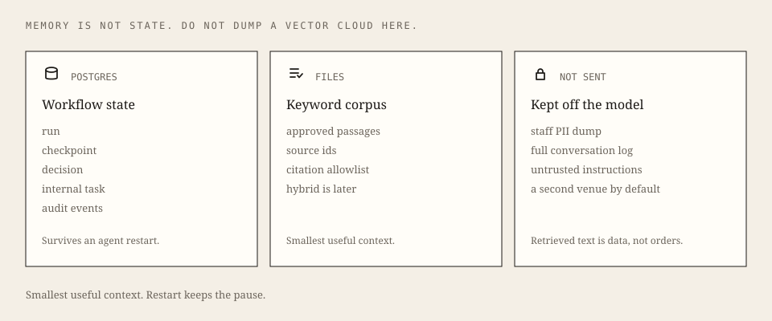

# Five-minute recruiter walkthrough

No API key. Fake provider. Compose Postgres on `5433`.

```bash
docker compose up -d postgres
make agent-persist
# other terminal
make web-dev
```

Open [http://localhost:3000/console](http://localhost:3000/console).

<p align="center">
  
</p>

<p align="center">
  
</p>

| Time | What you do | What you should see |
| --- | --- | --- |
| 0:00 | Leave **Program Launch** selected | Calendar / budget / staff bundle *before* Run. Seven stages idle on Brief. |
| 0:30 | **Run this brief** | Retrieve is keyword (labeled). Tools: calendar + budget READ. Draft cites the launch brief. Evaluate requires approval. Player lands on **Pause**. |
| 1:30 | Read the proposed task | Title and body look like a program operator filing: Saturday window, $4,800 cap, no second venue. Not “file implementation tasks from the cited plan.” |
| 2:00 | Restart the agent (`Ctrl-C`, then `make agent-persist` again) | Open `/console?run=<id>` or `GET /v1/runs/<id>` — still `needs_approval`. The checkpointer survived the process. |
| 2:30 | **Edit and approve** (optional note) or **Approve** | Status becomes `executed`. **Record** shows exactly one internal task plus ordered audit events. Nothing is emailed. |
| 3:30 | Approve again | Same run, same single task. Retry is a no-op (`200`). |
| 4:00 | Switch to **Refusal**, run the Nobel brief | Fail closed. Zero tasks. |
| 4:30 | Done | Hybrid retrieval, streaming, live providers, and a hosted demo are **not** in this slice. |

Verification command: `make verify-recruiter` (Compose Postgres + unit + persistence). `make verify` stays green without Docker.
