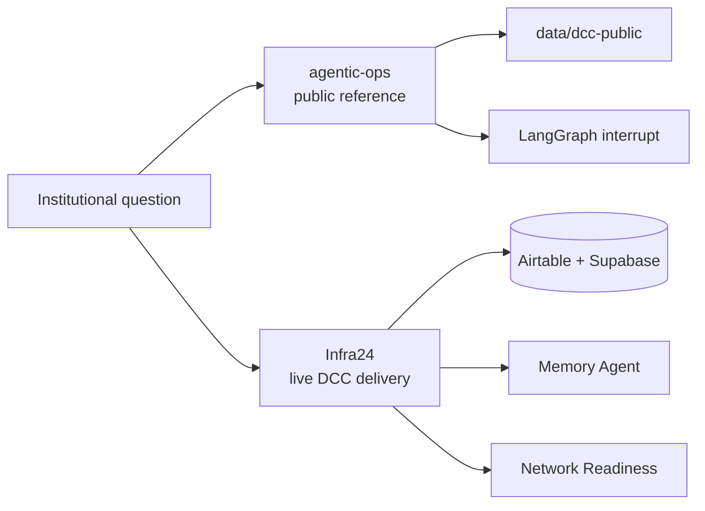
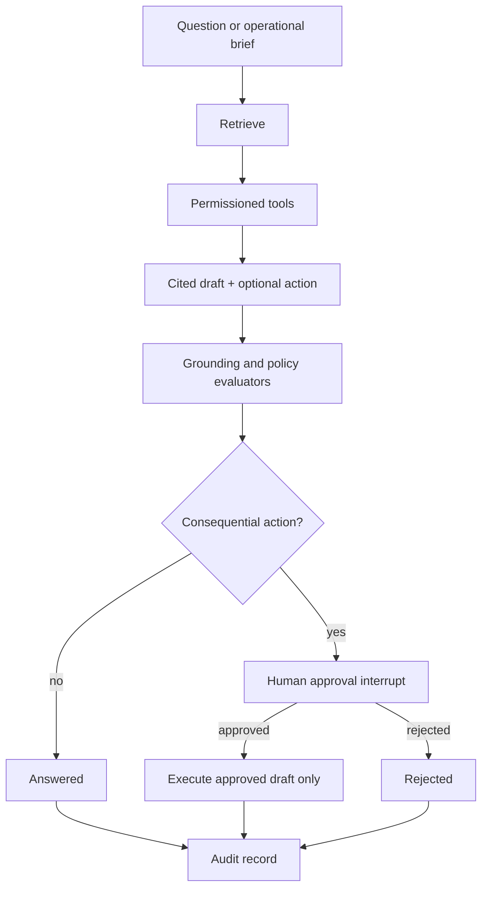

# Architecture

**Status:** v0 scaffold. The FastAPI/LangGraph path, keyword retrieval, citation
gate, and approval interrupt are implemented. pgvector, live providers, and
Bedrock eval are planned.

## Companion boundary

| Repo | Role |
| --- | --- |
| `moisestech/infra24` | Live customer-delivery platform. Memory Agent + Network Readiness on DCC. |
| `moisestech/agentic-evidence-pipeline` | TypeScript evidence/assessment pipeline. Adjacent proof. |
| `moisestech/agentic-ops` | Recruiter-readable Python + LangGraph + Vercel AI SDK reference. |

Infra24 is the production comparison, not a file to copy into this repo.

## Product workflow

## Run states

`queued → retrieving → drafting → evaluating → needs_approval | answered → executed | rejected | failed`

Invalid transitions fail. A process restart must not lose a pending approval
once Postgres checkpointer lands (in-memory checkpointer for v0 tests).

## Deterministic vs model-driven

| Deterministic | Model-driven |
| --- | --- |
| Load and chunk corpus | Map passages to an answer |
| Keyword (and later vector) retrieval | Optional action draft |
| Citation allowlist, policy markers | Bounded repair later |
| Approval / reject commands | — |
| Audit persistence | — |

## Stack

- FastAPI service with committed OpenAPI
- LangGraph state graph + interrupt/resume
- LangChain text splitters for chunking
- PostgreSQL + pgvector (Compose image present; retrieval is keyword-first)
- Next.js console with Vercel AI SDK types reserved for streaming
- Fake provider as the CI default
- Shared tool catalog + MCP-shaped stdio server
- Deterministic demo replay at `POST /v1/demo/replay`
